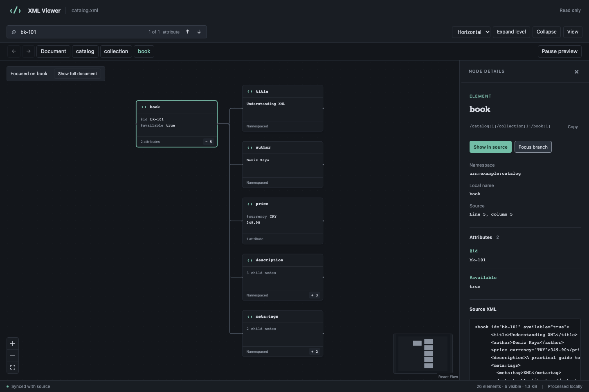

# XML Viewer

Explore XML inside VS Code as an interactive graph. Inspect namespaces, attributes and values, search the complete document, and jump between graph nodes and source code.



Repository: [ertanbicakci/xml-visual-viewer-vscode](https://github.com/ertanbicakci/xml-visual-viewer-vscode). Bug reports: [GitHub Issues](https://github.com/ertanbicakci/xml-visual-viewer-vscode/issues). The repository is currently private.

## Try it

1. Install the local `xml-visual-viewer-0.2.0.vsix` using **Extensions → … → Install from VSIX…**.
2. Open an XML document, for example `examples/catalog.xml`.
3. Run **XML Viewer: Open Visual Preview** from the Command Palette or the XML editor title.

The preview opens beside the source. You can also right-click an XML file in Explorer, or choose **Reopen Editor With → XML Viewer**. The normal XML text editor remains the default.

Requires VS Code 1.96 or newer. This is a local v0.2.0 beta package; the `local` publisher is a development identity, not a Marketplace publisher registration.

## Explore a document

- **Select a node** to inspect its XML name, namespace URI, attributes, value and source excerpt. **Show in source** selects its name in the text editor; clicking an attribute name selects its value.
- **Move the source cursor** to highlight the corresponding node. Neither action changes the document.
- **Expand a branch** with its `+` button or double-click. **Expand level** opens another visible level; **Collapse** returns to the document root.
- **Search** element names, namespace URIs, attributes and text. Enter/Shift+Enter or the arrow buttons move between matches. Results inside folded or paginated branches are revealed automatically.
- **Breadcrumbs and Back / Forward** navigate through the current selection history. History is bounded to 32 nodes and resets after a document update.
- **Focus branch** explores a selected subtree. **Show full document** returns to the whole tree.
- **Horizontal / Vertical** changes layout direction. Pan, zoom, Fit View and the minimap help with navigation.
- **View** toggles comments/instructions and whitespace/text nodes. Ordinary leaf text is normally inlined in its element card; mixed content preserves its order.
- Resize the details panel by dragging its divider, or focus the divider and press the arrow keys. Tab to graph nodes and press Enter/Space to select them. Reduced motion, VS Code themes and high contrast colors are supported.

Edits in the source update the preview after a configurable pause (400 ms by default), including unsaved changes. Expansion, pagination, focus and selection are restored when a node can be matched conservatively by its name/namespace, unique ID or unchanged content. Ambiguous matches clear selection. Viewport and layout positions are reused for unchanged topology. While processing or when XML is invalid, source navigation is paused. A last valid graph may remain visible with an explicit stale-state notice. Correcting the XML restores the preview. **Pause preview** or **Cancel** affects only the current panel. **Retry** reads the latest document; **Retry layout** recovers a failed layout worker. Syntax and namespace issues appear in VS Code Problems; **Show error in source** navigates to their current location.

## XML support and limits

The viewer supports well-formed XML 1.0, namespace scopes, repeated siblings, attributes, mixed content, CDATA, comments, processing instructions, numeric character references, and the five predefined XML entities. XML language-mode documents without a `.xml` extension, including untitled documents, can be opened through the command.

It does not edit or format XML, validate XSD/DTD schemas, execute XPath queries, export images or load external resources. XML 1.1 and DOCTYPE declarations are explicitly unsupported. A copied node path is a location label; it is not guaranteed to be an executable XPath expression.

Default budgets:

| Budget | Limit |
|---|---:|
| Document text, UTF-8 equivalent | 10 MiB |
| Model nodes, including text/metadata/document | 50,000 |
| Element nesting | 256 levels |
| Total attributes | 50,000 |
| Serialized model / worker transfer | 32 MiB |
| Parsing worker V8 old-generation heap | 256 MiB |
| Nodes drawn at once | 1,000 (configurable 100–2,000) |
| Children revealed per page | 100 |
| Parse job / layout job | 10 seconds each |
| Inspector value / source excerpt | 100,000 characters each |
| Inspector node details | 200 attributes; 4,096 characters/name or namespace; 100,000 combined text characters |
| Saved view anchors / layout cache | 1,000 anchors / 8 layouts per panel |

The first view shows a limited tree depth. Large sibling lists offer **more** buttons. When the visible graph budget is reached, collapse branches or focus a subtree. All search results use the complete parsed values; card summaries are shortened. Limits are enforced and are not a promise that every document below the limits has the same loading time.

## Settings

Settings are resource-scoped under **XML Viewer** in VS Code. New panels use these defaults. Saved per-panel direction and visibility choices are restored; changing the corresponding VS Code setting applies its new default to open active panels. Initial depth applies when there is no saved view.

| Setting | Default | Range / values |
|---|---:|---|
| `xmlViewer.direction` | `RIGHT` | `RIGHT`, `DOWN` |
| `xmlViewer.initialDepth` | `2` | 1–6; document is level zero |
| `xmlViewer.followSource` | `true` | Follow source cursor |
| `xmlViewer.showMetadata` | `false` | Comments and instructions |
| `xmlViewer.showWhitespace` | `false` | Whitespace and separate text nodes |
| `xmlViewer.updateDelay` | `400` | 50–3,000 ms |
| `xmlViewer.maxVisibleNodes` | `1000` | 100–2,000 |

## Troubleshooting

Use **View → Output → XML Viewer** for processing metadata (result code, duration, size, node count and settings). **XML Viewer: Copy Diagnostic Report** copies this metadata with extension/VS Code versions and platform. These reports omit XML content, file names, paths and raw parser messages. Problems entries display the local XML error message and source location. Use the source editor for details shortened by the inspector.

## Privacy

The extension processes XML within VS Code and its local webview/worker environment. In a remote VS Code workspace, parsing runs in that workspace's Extension Host. It has no telemetry, network service, account or API key. XML values are rendered as text; embedded scripts, URLs and external entities are not executed or fetched. React Flow's attribution is an ordinary link and is loaded only if you choose to open it.

## Development

Use Node.js 22 or newer and npm.

```sh
npm ci
npm run build
```

Press **F5** in VS Code to start the Extension Development Host, then run **XML Viewer: Open Visual Preview**. The launch configuration opens the sample catalog.

```sh
npm run check                 # TypeScript
npm test                      # XML, graph, protocol, worker and version tests
npx playwright install chromium
npm run test:e2e               # Browser UI and CSP tests
npm run test:extension         # Real VS Code + real webview and source navigation
npm run benchmark             # Parser/model timing report in artifacts/
npm run benchmark:ui          # Cold browser UI, search, update and renderer heap
npm run package               # Build a self-contained VSIX
```

`test:extension` uses an isolated profile under `.vscode-test/`. It uses an installed VS Code executable when available, or downloads a stable test build. Set `VSCODE_VERSION=1.96.0` (or `stable`) to download and test a specific version, or set `VSCODE_EXECUTABLE` to choose an executable. The explicit executable takes precedence. Actual command-to-interactive timings are written to `artifacts/extension-performance-<version>.json`. The test build exposes a loopback CDP port (9337) only while the integration test runs. On Linux, run the Extension Host tests under `xvfb-run`.

`npm run preview` starts a browser harness at `http://127.0.0.1:4173` after a build. It runs the same React interface with a sample document; source-navigation behavior is simulated in this harness. Demo files and integration tests are excluded from the VSIX.

## Structure

- `src/core/`: parser adapter, ordered XML model, source index and graph projection.
- `src/extension/`: VS Code custom editor, shared document controller, parsing worker and secure webview setup.
- `src/shared/`: validated message protocol, settings, bounded details and string-table model codec.
- `src/webview/`: React Flow workspace, XML cards, inspector and view state.
- `tests/`: core, browser and Extension Host checks.

See `PROJECT_PLAN.md` for the product plan and `docs/implementation.md` for implementation decisions. Third-party notices and license texts are included in `THIRD_PARTY_NOTICES.txt`.

## Beta and release status

Local macOS tests cover VS Code 1.96.0 and 1.143.1, with unit tests, browser UI/CSP tests and four theme palettes checked with axe. Automated accessibility checks cover tested states and do not replace screen-reader or OS forced-color testing. Example documents include a catalog, SOAP envelope, Maven POM and mixed Unicode content.

CI defines Windows/Linux/macOS × minimum/stable VS Code. The **Package verified beta** workflow produces a VSIX artifact only after that matrix passes; it does not publish to Marketplace. `npm run package` checks the VSIX allowlist, required files and identity, and writes its SHA-256 report to `artifacts/package-report.json`.

Before public release: register the publisher, decide repository/public asset visibility, verify the extension name, run the remote matrix, test on representative machines and collect beta feedback. See [release readiness](docs/release-readiness.md) for the current evidence and remaining gates. XPath, schema validation, editing and export remain outside this beta's scope.
